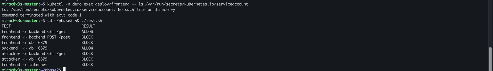

# Homelab Kubernetes Security Lab

A 6-node K3s cluster on three mini PCs, built to practise Kubernetes networking and security end to end: eBPF networking with encryption, zero-trust network policies, kernel-level runtime enforcement, event-driven autoscaling and Pod Security hardening. Every control is tested with a before/after result, not just installed.

I run the hardware at home and manage it remotely from abroad, so remote access and "don't lock yourself out" were part of the design from day one.

## Results at a glance

| Phase | What I built | Proof |
| --- | --- | --- |
| 1. Cluster | K3s in VMs, Cilium (eBPF, no kube-proxy), WireGuard pod encryption, Hubble | 6/6 nodes Ready, `Encryption: Wireguard (6/6 nodes)`, 83/83 connectivity tests passed |
| 2. Network policies | Default deny + L3/L4/L7 CiliumNetworkPolicies across web/api/data zones | 7/7 paths open → only the 2 intended paths open; attacker pod reaches nothing |
| 3. Runtime security | Tetragon TracingPolicy + Falco | `cat /etc/shadow` in a pod killed in the kernel (exit 137); Falco flags shells in containers |
| 4. Autoscaling | KEDA scaling a worker from a Redis queue | 0 → 10 replicas in seconds, queue drained, back to 0 after cooldown |
| 5. Hardening | Pod Security `restricted`, no SA tokens, kubelet locked down | Privileged/plain pods refused, token absent, kubelet 401 from network and unreachable from pods |
| 6. Real workload | [Foothold](https://github.com/miracaral/Foothold) API + Oracle Database under the same controls | 1 ALLOW / 5 BLOCK, every BLOCK confirmed as `Policy denied` in Hubble; non-root, read-only filesystem, no token |
| 7. Attack scenarios | Breakout, lateral movement and stolen-token attempts, before and after each control | 7/7 breakout pods admitted → 7/7 refused; hypervisor and router reachable from a pod → 66 flows `EGRESS DENIED`; stolen token reads a Secret → no connection / 401 / 403, one layer at a time |
| 8. AI agents | [k8s-agent-sandbox](https://github.com/miracaral/k8s-agent-sandbox): Gemini CLI as short-lived task pods, controlled by `labctl` | Task pod reaches only the Gemini API (nodes, router, internet, GitHub dropped); injected instructions ignored by the model, and stopped by key masking, egress and Redis ACL when a script obeyed them; daily limit counted atomically |



## Architecture

```
                    laptop (abroad, mobile data)
                      │                    ┆
                Tailscale (default)    WireGuard via VPS (backup, split tunnel)
                      │                    ┆
   ┌──────────────────▼────────────────────▼────────────── home LAN <LAN>.0/24 ──┐
   │  hv-1 (gateway + subnet router)     hv-2                  hv-3                  │
   │  ├─ cp-1   .110               ├─ worker-2 .112  ├─ worker-4 .114  │
   │  └─ worker-1 .111               └─ worker-3 .113  └─ worker-5 .115  │
   └─────────────────────────────────────────────────────────────────────────────────┘
        Pod traffic between nodes: Cilium eBPF datapath, WireGuard-encrypted
```

### Hardware

3 × Intel N100 mini PC (4 cores, 16 GB RAM, NVMe with ZFS), connected through a switch on the home LAN. Each runs Proxmox VE and hosts two VMs: 2 vCPU and 6 GB RAM each, so vCPUs map 1:1 to physical cores.

### Software

| Component | Version |
| --- | --- |
| Proxmox VE kernel | 6.17 |
| VM OS | Ubuntu 22.04 LTS cloud image |
| K3s | v1.36.5+k3s1 |
| Cilium | 1.20.1 (kube-proxy replacement, WireGuard, Hubble) |
| Tetragon, Falco (modern eBPF), KEDA | via Helm |

## Walkthrough

| # | Doc | Covers |
| --- | --- | --- |
| 1 | [Infrastructure](docs/01-infrastructure.md) | Moving K3s off the hypervisor, resource plan, ZFS ARC cap, Cloud-Init templates, the duplicate-IP bug, the `kvm64` CPU problem |
| 2 | [Remote access](docs/02-remote-access.md) | Diagnosing WireGuard drops hop by hop, Tailscale subnet router, split tunnel, mosh + tmux, SSH keys and the DNS chain reaction |
| 3 | [K3s + Cilium](docs/03-k3s-cilium.md) | Phase 1: CNI-less K3s, Cilium with WireGuard, connectivity tests, Hubble |
| 4 | [Network policies](docs/04-network-policies.md) | Phase 2: zones, default deny, L7 HTTP rules, L7 block vs L3 drop |
| 5 | [Runtime security](docs/05-runtime-security.md) | Phase 3: Tetragon detection and SIGKILL enforcement, Falco |
| 6 | [KEDA autoscaling](docs/06-keda-autoscaling.md) | Phase 4: scale-to-zero workers from a Redis queue, tainting the control plane; follow-up: Redis password, network policies and Pod Security for the queue |
| 7 | [Hardening](docs/07-hardening.md) | Phase 5: Pod Security Admission, ServiceAccount tokens, kubelet API, restricted pods |
| 8 | [Real workload](docs/08-real-workload.md) | Phase 6: a Java API and Oracle Database, a rogue-pod test, proving BLOCKs with Hubble, a rolling kernel patch |
| 9 | [Attack scenarios](docs/09-attack-scenarios.md) | Phase 7: container breakout, lateral movement, stolen credentials; which control stops which attempt; two findings (an ingress rule without `from`, pods reaching the home network); what was not measured |
| 10 | [AI agents](docs/10-ai-agents.md) | Phase 8: an AI coding agent in the sandbox from [k8s-agent-sandbox](https://github.com/miracaral/k8s-agent-sandbox); what a task pod and a stolen credential can reach, before and after; the brakes; prompt injection; problems found |
| 11 | [Security audit](docs/11-security-audit.md) | Threat model, self-attack with an injected agent, exposure check, repository scan (gitleaks), what was replaced by placeholders |

## Repository layout

```
.
├── docs/            step-by-step write-up for each phase
├── manifests/
│   ├── phase2-network-policies/   demo app + 6 CiliumNetworkPolicies
│   ├── phase3-runtime-security/   Tetragon TracingPolicyNamespaced
│   ├── phase4-keda/               Redis queue, worker, ScaledObject
│   ├── phase4b-jobs-lockdown/     the same queue with a password, 4 policies, "restricted"
│   ├── phase5-hardening/          demo app meeting Pod Security "restricted"
│   ├── phase7-attacks/            breakout pods, compromised pods, lab policies (read before applying)
│   └── phase8-ai-agents/          pointer to k8s-agent-sandbox, homelab-specific choices
├── scripts/         Proxmox template/clone, K3s + Cilium install, worker join,
│                    policy test matrix, KEDA load + watch, queue lockdown test,
│                    exposure check, attack scenarios, VPN watchdog
└── images/          screenshots of results
```

## Reproduce the security labs

On any cluster running Cilium (with L7 proxy enabled, the default), from a machine with `kubectl` access:

```bash
kubectl apply -f manifests/phase2-network-policies/00-app.yaml
./scripts/policy-test.sh                                   # everything ALLOW
kubectl apply -f manifests/phase2-network-policies/01-policies.yaml
./scripts/policy-test.sh                                   # 2 ALLOW / 5 BLOCK

helm install tetragon cilium/tetragon -n kube-system
kubectl apply -f manifests/phase3-runtime-security/block-shadow.yaml
kubectl -n demo exec deploy/attacker -- cat /etc/shadow    # exit code 137

kubectl -n demo patch serviceaccount default -p '{"automountServiceAccountToken": false}'
kubectl apply -f manifests/phase5-hardening/00-app-hardened.yaml
kubectl label --overwrite ns demo pod-security.kubernetes.io/enforce=restricted
```

## Lessons learned

1. Run Kubernetes inside VMs, not on the hypervisor, so a breakout cannot reach Proxmox.
2. Cloned cloud images can share a DHCP identity. Give cluster nodes static IPs.
3. Ubuntu cloud images disable SSH password login; inject keys with Cloud-Init (`qm set --sshkeys`).
4. Changing Cloud-Init settings regenerates SSH host keys, so a "host key changed" warning is expected.
5. Cloud-Init copies DNS from the host. If the host uses Tailscale DNS, the VMs lose name resolution.
6. `curl -s` hides errors. Run install scripts without `-s` the first time.
7. Proxmox's default `kvm64` CPU hides x86-64-v2 features; modern eBPF tools need `--cpu host`.
8. Mobile carriers may throttle UDP. When a VPN drops, measure hop by hop before changing anything.
9. A full tunnel takes your whole internet down when it breaks. A split tunnel is enough for lab access.
10. Disable Tailscale key expiry on remote servers or you get locked out after 180 days.
11. Scope enforcement policies. A cluster-wide "kill on /etc/shadow read" also kills `sshd` and `sudo`.
12. `warn=restricted` before `enforce=restricted`: the warnings are a ready-made hardening checklist.
13. K3s does not taint its server node. Taint it if the control plane should not run workloads.
14. A persistent volume mounted over an image's data directory hides what the image shipped there (Oracle `-faststart` → ORA-00205).
15. A test that only ever says BLOCK proves nothing. Keep one expected ALLOW in every matrix and confirm drops in Hubble.
16. The Cilium agent runs on the host network: point `hubble observe` at the Relay's IP, not its DNS name.
17. Patch the hypervisor and the VMs separately; draining one node at a time keeps the cluster up.

## Known limitations

Found and measured, not fixed in this version:

- **Pods in namespaces without a network policy reach the nodes and the home network** (`default`, `keda`, `falco`, `kube-system`). Measured in Phase 7 for a pod without policy ([finding 2](docs/09-attack-scenarios.md#finding-2-a-pod-could-reach-the-home-network)). The namespaces this lab uses (`demo`, `foothold`, `jobs`, `agents`, `agents-ops`) have default-deny.
- **The `default` namespace has no Pod Security label**, so a privileged pod is admitted there.
- **The Foothold API accepts connections from any pod** whose own namespace does not restrict egress ([finding 1](docs/09-attack-scenarios.md#finding-1-the-foothold-api-accepted-connections-from-any-pod)).
- **DNS is a way out from the AI agents' task pods**: they may look up any name, and lookups are also forwarded with the home network's search suffix to the router ([doc 10](docs/10-ai-agents.md#8g-not-measured)).
- **Addresses and names are placeholders.** `<LAN>`, `<WG>`, `cp-1`, `worker-N`, `hv-N` stand for this homelab's real values; set your own before running a script.

## Next steps

- Lower the server VM to 4 GB RAM
- Exclude the node IPs from the router's DHCP pool
- Make the VPN watchdog check handshake age instead of ping
- Cluster-wide default-deny, with exceptions for system namespaces: pods in namespaces without a network policy still reach the nodes and the home network ([finding 2](docs/09-attack-scenarios.md#finding-2-a-pod-could-reach-the-home-network))
- Restrict the Foothold API's ingress to named senders ([finding 1](docs/09-attack-scenarios.md#finding-1-the-foothold-api-accepted-connections-from-any-pod))
- Pod Security label for the `default` namespace

## License

[MIT](LICENSE)
