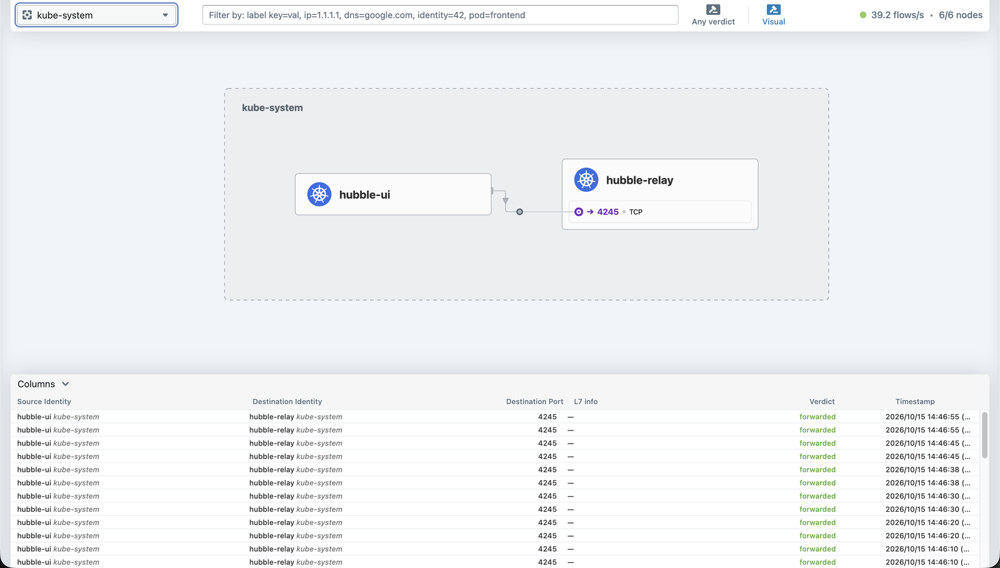

# 3. Phase 1: K3s + Cilium + WireGuard encryption

[← Back to README](../README.md)

**Result:** 6/6 nodes Ready, Cilium on every node, pod-to-pod traffic between nodes encrypted with WireGuard, and 83/83 connectivity tests passing.

I ran all install commands inside tmux on pve1. pve1 and the VMs share the LAN, so a dropped mobile connection could not interrupt an install halfway.

## Server without a CNI

K3s ships with flannel, kube-proxy and traefik. Cilium replaces the first two, so I disabled them at install time rather than ripping them out later. Full script: [`scripts/install-k3s-cilium.sh`](../scripts/install-k3s-cilium.sh).

```bash
curl -fL https://get.k3s.io | INSTALL_K3S_EXEC="server \
  --flannel-backend=none --disable-network-policy --disable-kube-proxy \
  --disable=traefik --disable=servicelb \
  --node-ip=192.168.1.110 --write-kubeconfig-mode=644" sh -
```

| Flag | Why |
| --- | --- |
| `--flannel-backend=none` | Cilium is the CNI |
| `--disable-network-policy` | Cilium enforces network policy |
| `--disable-kube-proxy` | Service routing in eBPF instead |
| `--disable=traefik,servicelb` | Not needed for this lab |
| `--node-ip` | Talk on the right interface |

The node stays `NotReady` until a CNI is installed. That is expected.

## Cilium with WireGuard

```bash
cilium install \
  --set kubeProxyReplacement=true \
  --set k8sServiceHost=192.168.1.110 --set k8sServicePort=6443 \
  --set encryption.enabled=true --set encryption.type=wireguard \
  --set ipam.operator.clusterPoolIPv4PodCIDRList=10.42.0.0/16 \
  --set operator.replicas=1
```

Without kube-proxy, Cilium cannot use the `kubernetes` Service to find the API server, so `k8sServiceHost/Port` has to point at it directly.

## Joining the workers

[`scripts/join-workers.sh`](../scripts/join-workers.sh) reads the join token from the server and passes it straight to each agent, so it is never copied by hand or written anywhere.

## Verification

```
NAME           STATUS   ROLES           VERSION        INTERNAL-IP
k3s-master     Ready    control-plane   v1.36.5+k3s1   192.168.1.110
k3s-worker-1   Ready    worker          v1.36.5+k3s1   192.168.1.111
k3s-worker-2   Ready    worker          v1.36.5+k3s1   192.168.1.112
k3s-worker-3   Ready    worker          v1.36.5+k3s1   192.168.1.113
k3s-worker-4   Ready    worker          v1.36.5+k3s1   192.168.1.114
k3s-worker-5   Ready    worker          v1.36.5+k3s1   192.168.1.115

DaemonSet   cilium         Desired: 6, Ready: 6/6, Available: 6/6
DaemonSet   cilium-envoy   Desired: 6, Ready: 6/6, Available: 6/6
Encryption: Wireguard (6/6 nodes)
```

```bash
cilium connectivity test
```

```
✅ [cilium-test-1] All 83 tests (798 actions) successful, 52 tests skipped, 0 scenarios skipped.
```

The passing tests include `pod-to-pod-encryption-v2` and `node-to-node-encryption`. The skipped ones need features I left off (ingress controller, egress gateway).

## Hubble

```bash
cilium hubble enable --ui
kubectl -n kube-system port-forward svc/hubble-ui 12000:80
```



## Snapshot before the security work

```bash
for id in 901 902; do qm snapshot $id phase1-ok; done
# roll back with: qm rollback <id> phase1-ok
```

I took a snapshot like this at the end of every phase.
