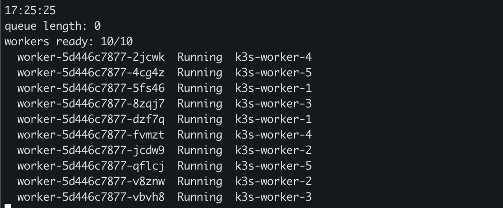

# 6. Phase 4: queue-driven autoscaling with KEDA

[← Back to README](../README.md)

**Result:** a worker deployment idling at 0 replicas scaled to 10 within seconds of 200 jobs landing in a Redis queue, spread across the nodes, drained the queue in about 1.5 minutes, and went back to 0 about 37 seconds after the queue emptied.

## Pieces

| File | What it is |
| --- | --- |
| [`00-queue.yaml`](../manifests/phase4-keda/00-queue.yaml) | Namespace `jobs`, Redis deployment and service; the list `jobs` is the queue |
| [`01-worker.yaml`](../manifests/phase4-keda/01-worker.yaml) | Worker deployment, `replicas: 0`; each pod pops a job with `BRPOP`, works 3 s, repeats |
| [`02-scaledobject.yaml`](../manifests/phase4-keda/02-scaledobject.yaml) | KEDA ScaledObject: 1 replica per 5 queued jobs, 0 to 10 replicas |
| [`push-jobs.sh`](../scripts/push-jobs.sh) | Pushes N jobs onto the queue |
| [`keda-watch.sh`](../scripts/keda-watch.sh) | Queue length, ready workers and their nodes every 2 s |

```yaml
apiVersion: keda.sh/v1alpha1
kind: ScaledObject
metadata: {name: worker-scaler, namespace: jobs}
spec:
  scaleTargetRef: {name: worker}
  minReplicaCount: 0
  maxReplicaCount: 10
  pollingInterval: 5
  cooldownPeriod: 30
  triggers:
  - type: redis
    metadata:
      address: redis.jobs.svc.cluster.local:6379
      listName: jobs
      listLength: "5"
```

## Run

```bash
helm repo add kedacore https://kedacore.github.io/charts
helm install keda kedacore/keda -n keda --create-namespace

kubectl apply -f manifests/phase4-keda/00-queue.yaml
kubectl apply -f manifests/phase4-keda/01-worker.yaml -f manifests/phase4-keda/02-scaledobject.yaml
kubectl -n jobs get scaledobject        # READY True, ACTIVE False

./scripts/keda-watch.sh                 # terminal 1
./scripts/push-jobs.sh 200              # terminal 2
```

| Time | Queue | Workers |
| --- | --- | --- |
| 0:00 | 0 | 0/0 |
| +2:30 | 134 | 10/10 on all six nodes |
| +3:38 | 0 | 10/10, cooldown running |
| +4:15 | 0 | 0/0 |

## One worker landed on the control plane

```
worker-5d446c7877-x4bp8  Running  worker-1
worker-5d446c7877-zp497  Running  cp-1      <-- here
...
```

K3s does not taint its server node, so it takes regular workloads. My server VM shares a host with the VPN gateway and is the node closest to its RAM limit, so I want it to run only the control plane and the per-node agents:

```bash
kubectl taint node cp-1 node-role.kubernetes.io/control-plane:NoSchedule
./scripts/push-jobs.sh 100
```

Existing pods stay; the DaemonSets (Cilium, Tetragon, Falco) tolerate the taint. The second run put 10 workers on the five worker nodes, two each, none on the server:



## Follow-up: locking down the queue

**Result:** the Redis queue went from "any pod in the cluster can read and write it without a password" to password-protected, reachable only by the worker and the KEDA operator, and running under Pod Security `restricted`. KEDA still scales the worker from 0 and back.

Phase 4 was about autoscaling, so the `jobs` namespace was left open: no password, no network policy, no Pod Security label. The Phase 4 manifests stay as they were; the secured version is re-declared in its own folder, the same way Phase 5 re-declared the demo app.

| File | What it is |
| --- | --- |
| [`00-queue-secured.yaml`](../manifests/phase4b-jobs-lockdown/00-queue-secured.yaml) | Redis, worker, ScaledObject and a new TriggerAuthentication, with the password and the `restricted` settings |
| [`01-policies.yaml`](../manifests/phase4b-jobs-lockdown/01-policies.yaml) | Four CiliumNetworkPolicies for `jobs` |
| [`jobs-test.sh`](../scripts/jobs-test.sh) | Network, password and Pod Security checks in one run |
| [`exposure-check.sh`](../scripts/exposure-check.sh) | Shows that nothing in a namespace is reachable from outside the cluster |

### Password

The password lives in a Secret that is created by hand and never committed:

```bash
( umask 077
  d=$(mktemp -d -p /dev/shm)
  openssl rand -hex 24 | tr -d '\n' > "${d:?}/password"
  kubectl -n jobs create secret generic redis-auth --from-file="${d:?}"
  rm -rf "${d:?}" )
```

The first version of this page used `--from-literal=password="$(openssl rand -hex 24)"`. That puts the password into the arguments of the `kubectl` process, where anything that records process arguments can keep it. The form above writes it to a file in memory instead. The password created the old way was replaced during the [security audit](11-security-audit.md).

Three places use it:

```yaml
# Redis: written to a config file at start, not passed as an argument
command: ["sh", "-c"]
args:
- |
  umask 077
  printf 'requirepass %s\n' "$REDIS_PASSWORD" > /tmp/redis.conf
  exec redis-server /tmp/redis.conf

# Worker: redis-cli reads this variable by itself
env:
- name: REDISCLI_AUTH
  valueFrom: {secretKeyRef: {name: redis-auth, key: password}}

# KEDA: a TriggerAuthentication points at the Secret, the ScaledObject references it
kind: TriggerAuthentication
spec:
  secretTargetRef:
  - {parameter: password, name: redis-auth, key: password}
```

`--requirepass <password>` on the command line would have been shorter, but Tetragon (Phase 3) records every process with its arguments, so the password would have ended up in the event stream. `/tmp` is a memory-backed `emptyDir`, so the config file never touches the node's disk.

The `sh -c` wrapper replaces the image's entrypoint, and that entrypoint is what normally drops from root to the `redis` user. Without `runAsUser: 999` this change would have made Redis run as root.

### Network policies

| Policy | Effect |
| --- | --- |
| `default-deny` | Every pod in `jobs` denied in both directions |
| `allow-dns` | Egress to kube-dns on port 53 only |
| `worker-to-redis` | Worker → Redis on TCP 6379 |
| `redis-ingress` | Redis accepts only the worker and the KEDA operator |

The KEDA operator runs in another namespace, so `redis-ingress` selects it by namespace and label together. Without that entry KEDA cannot read the queue length and scaling stops without any error in `jobs`:

```yaml
ingress:
- fromEndpoints:
  - matchLabels: {app: worker}
  - matchLabels:
      k8s:io.kubernetes.pod.namespace: keda
      app: keda-operator
  toPorts:
  - ports: [{port: "6379", protocol: TCP}]
```

### Pod Security

Same method as [Phase 5](07-hardening.md): dry-run the label, fix what it reports, `warn`, then `enforce`.

```bash
kubectl label --dry-run=server --overwrite ns jobs pod-security.kubernetes.io/enforce=restricted
# Warning: redis-56b5c4948-vck5g: allowPrivilegeEscalation != false, unrestricted capabilities, runAsNonRoot != true, seccompProfile

kubectl apply -f manifests/phase4b-jobs-lockdown/00-queue-secured.yaml
kubectl label --overwrite ns jobs pod-security.kubernetes.io/warn=restricted
kubectl label --dry-run=server --overwrite ns jobs pod-security.kubernetes.io/enforce=restricted    # no warnings now
kubectl label --overwrite ns jobs pod-security.kubernetes.io/enforce=restricted
```

Both pods also get a read-only root filesystem and no ServiceAccount token, which `restricted` does not require. Redis writes its snapshot to `/data`, so `/data` became an `emptyDir`.

### Before and after

Two throwaway pods, chosen so that each tests a different rule. A pod in `default` has no policy of its own, so only Redis's **ingress** rule can stop it. A rogue pod inside `jobs` meets `restricted` but is not the worker, so `default-deny` stops it at its own **egress**.

| Path | Before | With password | With policies |
| --- | --- | --- | --- |
| pod in `default` → Redis | `PONG`, reads and writes | `NOAUTH` | **dropped** (INGRESS DENIED) |
| rogue pod in `jobs` → Redis | not measured | not measured | **dropped** (EGRESS DENIED) |
| rogue pod in `jobs` → internet | not measured | not measured | **dropped** (EGRESS DENIED) |
| worker → Redis | works | works | works |
| KEDA operator → Redis | works | works | works |

| Check | Before | After |
| --- | --- | --- |
| `enforce=restricted` dry run | 4 violations on the Redis pod | none |
| Privileged pod in `jobs` | not measured (no label on the namespace) | **refused** |
| Plain root pod in `jobs` | not measured (no label on the namespace) | **refused** |
| Redis root filesystem | writable | **read-only** |
| ServiceAccount token in Redis and worker | mounted | **absent** |
| Redis CPU / memory limit | none | 500m / 256Mi |
| Password in the process arguments | no password at all | **no** (`redis-server *:6379`) |

With only the password, the probe still got an answer from Redis (`NOAUTH`). With the policies it gets nothing: the packet never arrives. Hubble confirms which rule made each decision:

```
default/redis-probe:35079 <> jobs/redis-56b5c4948-vck5g:6379  policy-verdict:none INGRESS DENIED (TCP Flags: SYN)
jobs/rogue:34715          <> jobs/redis-56b5c4948-vck5g:6379  policy-verdict:none EGRESS DENIED (TCP Flags: SYN)
jobs/rogue:46067          <> 1.1.1.1:443 (world)              policy-verdict:none EGRESS DENIED (TCP Flags: SYN)
jobs/worker-5975d99d47-ggq8h -> jobs/redis-56b5c4948-vck5g:6379  policy-verdict:L3-L4 INGRESS
```

The first line is the one Phase 6 could not show: there every drop was EGRESS DENIED, so the receiving side's rule was never tested on its own ([Real workload, 6c](08-real-workload.md)). Here the sender is unrestricted and Redis's ingress rule does the work.

KEDA with everything in place, 20 jobs at one worker per 5:

| Time | Queue | Workers |
| --- | --- | --- |
| +0 s | 20 | 0/0 |
| +11 s | 14 | 4/4 |
| +22 s | 0 | 4/4, cooldown running |
| +49 s | 0 | 0/0 |

### One script for all of it

```bash
./scripts/jobs-test.sh
```

```
== Network policies (namespace jobs)
TEST                                             RESULT
probe (default) -> redis:6379 (by service IP)    BLOCK
rogue (jobs)    -> redis:6379 (by service IP)    BLOCK
rogue (jobs)    -> internet (1.1.1.1:443)        BLOCK
KEDA + worker -> redis (5 jobs drained)          ALLOW

== Redis password
redis-cli PING without a password                NOAUTH Authentication required.
redis-cli PING with a wrong password             WRONGPASS
redis-cli PING with the Secret                   PONG
password in the process arguments?               NO

== Pod Security restricted (namespace jobs)
privileged pod admitted?                         NO (refused)
plain pod (root, no securityContext)?            NO (refused)
redis runs as                                    999 (non-root)
redis can write to its root filesystem?          NO (read-only)
redis has a ServiceAccount token?                NO
```

The ALLOW line pushes 5 jobs and waits for the queue to reach 0. That can only happen if KEDA read the queue and a worker reached Redis, so it keeps the matrix from being all BLOCK.

### Nothing exposed outside the cluster

```bash
./scripts/exposure-check.sh jobs
```

```
SERVICE   TYPE        EXTERNAL-IPS   NODEPORTS
redis     ClusterIP   <none>         <none>
services that are not ClusterIP          0
services with externalIPs                0
Ingress objects                          0
pods with hostNetwork                    0
containers with a hostPort               0
```

From a laptop on the node network, port 6379 is closed on all six nodes.
