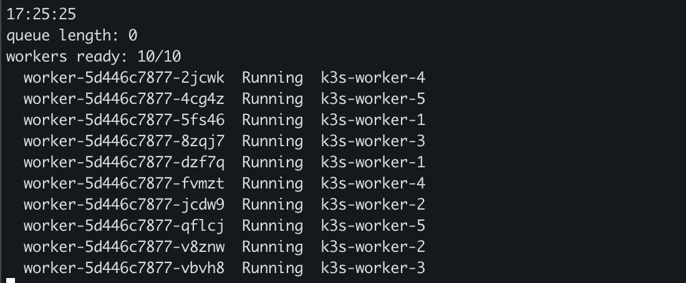

# 6. Phase 4: queue-driven autoscaling with KEDA

[← Back to README](../README.md)

**Result:** a worker deployment idling at 0 replicas scaled to 10 within seconds of 200 jobs landing in a Redis queue, spread across the nodes, drained the queue in about 1.5 minutes, and went back to 0 about 37 seconds after the queue emptied.

## Pieces

| File | What it is |
| --- | --- |
| [`00-queue.yaml`](../manifests/phase4-keda/00-queue.yaml) | Namespace `jobs`, Redis deployment and service; the list `jobs` is the queue |
| [`01-worker.yaml`](../manifests/phase4-keda/01-worker.yaml) | Worker deployment, `replicas: 0`; each pod pops a job with `BRPOP`, works 3 s, repeats |
| [`02-scaledobject.yaml`](../manifests/phase4-keda/02-scaledobject.yaml) | KEDA ScaledObject: 1 replica per 5 queued jobs, 0 to 10 replicas |
| [`push-jobs.sh`](../scripts/push-jobs.sh) | Pushes N jobs onto the queue |
| [`keda-watch.sh`](../scripts/keda-watch.sh) | Queue length, ready workers and their nodes every 2 s |

```yaml
apiVersion: keda.sh/v1alpha1
kind: ScaledObject
metadata: {name: worker-scaler, namespace: jobs}
spec:
  scaleTargetRef: {name: worker}
  minReplicaCount: 0
  maxReplicaCount: 10
  pollingInterval: 5
  cooldownPeriod: 30
  triggers:
  - type: redis
    metadata:
      address: redis.jobs.svc.cluster.local:6379
      listName: jobs
      listLength: "5"
```

## Run

```bash
helm repo add kedacore https://kedacore.github.io/charts
helm install keda kedacore/keda -n keda --create-namespace

kubectl apply -f manifests/phase4-keda/00-queue.yaml
kubectl apply -f manifests/phase4-keda/01-worker.yaml -f manifests/phase4-keda/02-scaledobject.yaml
kubectl -n jobs get scaledobject        # READY True, ACTIVE False

./scripts/keda-watch.sh                 # terminal 1
./scripts/push-jobs.sh 200              # terminal 2
```

| Time | Queue | Workers |
| --- | --- | --- |
| 0:00 | 0 | 0/0 |
| +2:30 | 134 | 10/10 on all six nodes |
| +3:38 | 0 | 10/10, cooldown running |
| +4:15 | 0 | 0/0 |

## One worker landed on the control plane

```
worker-5d446c7877-x4bp8  Running  k3s-worker-1
worker-5d446c7877-zp497  Running  k3s-master      <-- here
...
```

K3s does not taint its server node, so it takes regular workloads. My server VM shares a host with the VPN gateway and is the node closest to its RAM limit, so I want it to run only the control plane and the per-node agents:

```bash
kubectl taint node k3s-master node-role.kubernetes.io/control-plane:NoSchedule
./scripts/push-jobs.sh 100
```

Existing pods stay; the DaemonSets (Cilium, Tetragon, Falco) tolerate the taint. The second run put 10 workers on the five worker nodes, two each, none on the server:


