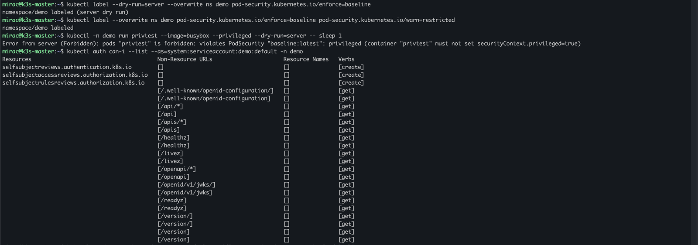

# 7. Phase 5: hardening and verification

[← Back to README](../README.md)

Each step closes a known Kubernetes risk and then proves that the control works.

## 5a. Pod Security Admission

The built-in admission controller enforces a Pod Security Standard per namespace. `baseline` rejects privileged containers and host namespaces. `warn=restricted` only reports what the stricter level would flag.

```bash
# check what existing pods would violate (changes nothing)
kubectl label --dry-run=server --overwrite ns demo pod-security.kubernetes.io/enforce=baseline

kubectl label --overwrite ns demo \
  pod-security.kubernetes.io/enforce=baseline \
  pod-security.kubernetes.io/warn=restricted

# a privileged pod is refused (server-side dry run, nothing is created)
kubectl -n demo run privtest --image=busybox --privileged --dry-run=server -- sleep 1
```



## 5b. No ServiceAccount token where none is needed

Every pod gets a ServiceAccount token by default. None of the demo apps talk to the Kubernetes API, so the token is just an identity an attacker could steal. The default identity in `demo` can only do self-reviews and discovery (screenshot above), but the cleanest fix is not to mount it at all:

```bash
kubectl -n demo patch serviceaccount default -p '{"automountServiceAccountToken": false}'
kubectl -n demo rollout restart deploy
kubectl -n demo rollout status deploy --timeout=180s

kubectl -n demo exec deploy/frontend -- ls /var/run/secrets/kubernetes.io/serviceaccount
./scripts/policy-test.sh      # the Phase 2 policies still hold after the restart
```


The restart also showed `warn=restricted` at work: for every pod, admission listed what the strictest level would require (`allowPrivilegeEscalation=false`, `capabilities.drop=["ALL"]`, `runAsNonRoot=true`, `seccompProfile=RuntimeDefault`). That list became the to-do for 5d.

## 5c. Kubelet API, two layers

Each node's kubelet serves an API on port 10250.

```bash
# from the node network, no credentials → authentication required
curl -sk -o /dev/null -w "%{http_code}\n" https://192.168.1.111:10250/pods
401

# from a pod → the request never reaches the kubelet
kubectl -n demo exec deploy/attacker -- curl -sk -m 4 -o /dev/null -w "%{http_code}\n" https://192.168.1.111:10250/pods
000
```

The 401 is kubelet authentication (K3s disables anonymous access). The 000 is the Phase 2 `default-deny` dropping pod-to-node traffic. Two independent layers: even a kubelet misconfiguration would not be reachable from a workload.

## 5d. Restricted Pod Security for the demo app

[`manifests/phase5-hardening/00-app-hardened.yaml`](../manifests/phase5-hardening/00-app-hardened.yaml) re-declares the demo app to meet `restricted`. Labels are unchanged, so the network policies still select the same pods.

```yaml
# per pod
securityContext:
  runAsNonRoot: true
  runAsUser: 1000          # 999 for redis
  runAsGroup: 1000
  seccompProfile: {type: RuntimeDefault}
# per container
securityContext:
  allowPrivilegeEscalation: false
  capabilities: {drop: ["ALL"]}
```

```bash
kubectl apply -f manifests/phase5-hardening/00-app-hardened.yaml
kubectl -n demo rollout status deploy --timeout=180s
kubectl label --overwrite ns demo pod-security.kubernetes.io/enforce=restricted

kubectl -n demo exec deploy/frontend -- id     # uid=1000 gid=1000
kubectl -n demo exec deploy/db -- id           # uid=999(redis)

# a plain pod with no security settings is now refused
kubectl -n demo run plaintest --image=busybox --dry-run=server -- sleep 1
# Forbidden: violates PodSecurity "restricted:latest": allowPrivilegeEscalation != false,
# unrestricted capabilities, runAsNonRoot != true, seccompProfile

./scripts/policy-test.sh   # still 2 ALLOW / 5 BLOCK
```

When I applied the label, one attacker pod was listed as non-compliant. It was the old replica still in its 30 s termination grace period (`sleep infinity` ignores SIGTERM). A new enforce level never evicts running pods; it only checks new ones.

## Summary

| Risk | Control | Verified by |
| --- | --- | --- |
| Privileged container reaching the host | Pod Security `baseline`, then `restricted` | Privileged and plain pods refused at admission |
| Stolen ServiceAccount token | `automountServiceAccountToken: false` | Token directory absent in pods |
| Kubelet API abuse | Kubelet auth + pod-to-node egress denied | 401 from the node network, 000 from a pod |
| Lateral movement between workloads | Cilium default deny + L3/L7 allow rules | 2 ALLOW / 5 BLOCK |
| Sensitive file read inside a pod | Tetragon Sigkill policy | `cat /etc/shadow` exits 137 |
| Root inside containers | `runAsNonRoot`, capabilities dropped, seccomp | `id` shows uid 1000 / 999 |
