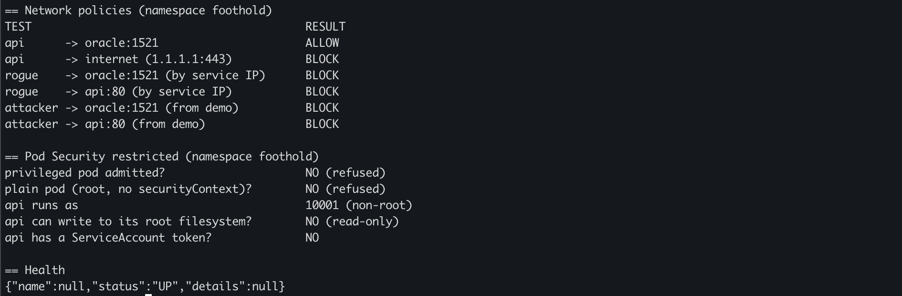
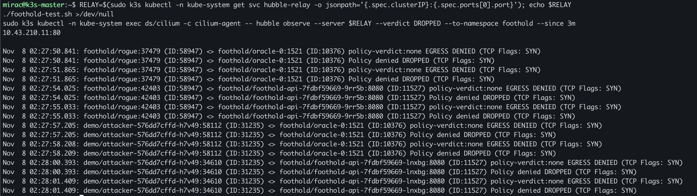

# 8. Phase 6: a real workload under the lab's controls

[← Back to README](../README.md)

Phases 2 to 5 secured a demo app. This phase runs a real one: [Foothold](https://github.com/miracaral/Foothold), a Java 17 / Micronaut API with an Oracle Database, deployed from its own repo's [`k8s/`](https://github.com/miracaral/Foothold/tree/main/k8s) manifests into a `foothold` namespace. The question is the same as before: does each control hold, and can I prove it?

## 6a. What runs

| Piece | How it is deployed | Controls |
| --- | --- | --- |
| Namespace `foothold` | Pod Security label `enforce=restricted` | No privileged or root pods are admitted |
| Oracle Database Free | StatefulSet, 1 replica, 5 GiB local-path volume | Non-root (uid 54321), all capabilities dropped |
| Foothold API | Deployment, 2 replicas, image from GHCR | Non-root (uid 10001), read-only root filesystem, no ServiceAccount token, health probes |
| Network policies | `default-deny` + two allow rules | Only the API may reach Oracle; the API may only reach Oracle and DNS |

The API image is built and pushed to `ghcr.io/miracaral/foothold-api` by the Foothold repo's CI on every push to `main`; the cluster pulls it like any other public image.

## 6b. Verification

[`scripts/foothold-test.sh`](../scripts/foothold-test.sh) runs on the control-plane node. It places a **rogue pod** inside the `foothold` namespace (one that satisfies Pod Security `restricted`, so admission lets it in and only the network policies can stop it), reuses the Phase 2 **attacker** pod in `demo`, and checks Pod Security from inside the API container.

```bash
./scripts/foothold-test.sh
```



| Path | Result | Why |
| --- | --- | --- |
| API → Oracle :1521 | ALLOW | The one path the app needs |
| API → internet | BLOCK | API egress allows only Oracle and DNS |
| rogue (same namespace) → Oracle | BLOCK | `default-deny` covers every pod without the API's label |
| rogue → API | BLOCK | Same: the rogue pod has no egress at all |
| attacker (`demo`) → Oracle | BLOCK | `demo`'s Phase 2 policies give the attacker no egress |
| attacker → API | BLOCK | Same |

Pod Security: a privileged pod and a plain root pod are both refused; the API runs as uid 10001, cannot write to its root filesystem and has no ServiceAccount token.

## 6c. Proving the BLOCKs are real

A BLOCK only means "the connection did not succeed". It could also mean the test itself never ran. To rule that out, Hubble records why each packet was dropped. The Cilium agent runs on the host network and cannot resolve cluster DNS names, so it is pointed at the Hubble Relay by IP, which aggregates every node:

```bash
RELAY=$(kubectl -n kube-system get svc hubble-relay -o jsonpath='{.spec.clusterIP}:{.spec.ports[0].port}')
./scripts/foothold-test.sh >/dev/null
kubectl -n kube-system exec ds/cilium -c cilium-agent -- \
  hubble observe --server $RELAY --verdict DROPPED --to-namespace foothold --since 3m
```



Every blocked connection appears as `Policy denied DROPPED`, and every one is `EGRESS DENIED`: the packet is dropped by the **sender's** own policy before it leaves its pod. Oracle's ingress rule ("only from the API") is a second layer that these tests never had to reach. That is defense in depth working as intended, but it also means the ingress rule is not tested on its own here.

## 6d. Problems found while deploying

| Symptom | Cause | Fix |
| --- | --- | --- |
| `ORA-00205: error in identifying control file` | The `-faststart` Oracle image ships prebuilt data files in `/opt/oracle/oradata`; the persistent volume mounted there hid them | Use the regular `23-slim` image, which creates the database inside the volume |
| `ORA-01081: cannot start already-running ORACLE` after restarts | Leftovers of the crashed first start inside the same pod | Delete the StatefulSet and its volume claim, re-apply |
| API: `SocketException: Operation not permitted` | Oracle was not ready yet; the `oracle` service had no endpoints, so Cilium refused the connection | Resolved itself once Oracle passed its readiness probe |
| Placeholder passwords applied | The example secret sat next to the real one in `k8s/`, so `kubectl apply -f k8s/` applied both | Example moved to `k8s/examples/`; passwords generated with `openssl rand` |
| First test run: every path BLOCK, including API → Oracle | `timeout` cannot run shell functions, so no connection was ever attempted | Run `timeout` inside the container; check results against `/health` and Hubble |

The last one is the reason for 6c: the first, wrong run looked like a perfect result. It was caught only because the API → Oracle path was expected to be ALLOW.

## 6e. Maintenance: a rolling kernel patch

Two days before this phase, CVE-2026-98432 (a critical remote Linux kernel flaw) had to be patched on both layers: the Proxmox hosts (kernel 7.0.14-28-pve) and the six Ubuntu VMs (5.15.0-203-generic). Each node was drained, upgraded, rebooted and uncordoned in turn, so the cluster never went fully down; Foothold was briefly unavailable only while the node holding Oracle's volume rebooted. Its data survived on the local volume.

```bash
kubectl get nodes -o custom-columns=NAME:.metadata.name,KERNEL:.status.nodeInfo.kernelVersion
```
